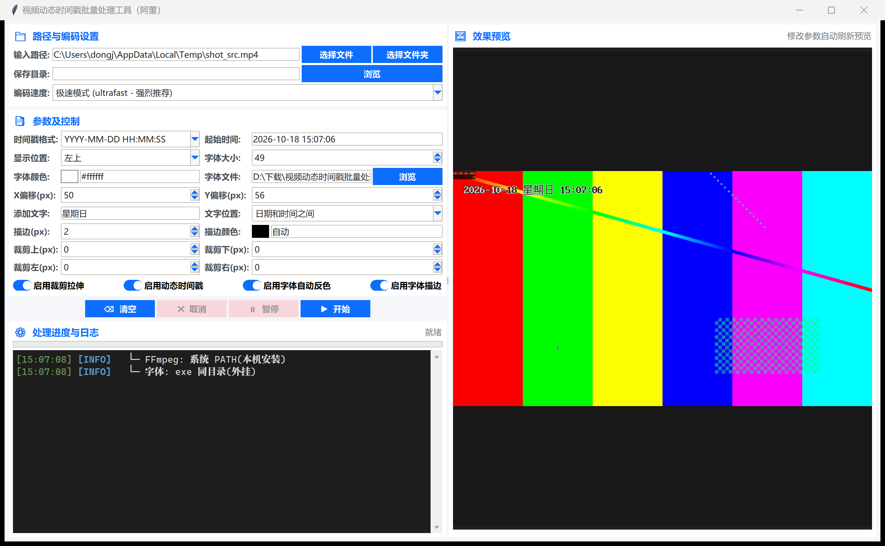

<div align="center">

# 视频动态时间戳批量处理工具

**给批量视频叠加"逐秒跳动"的动态时间戳水印的 Windows 桌面工具 —— 支持实时预览、自动反色、裁剪拉伸与按 15MB 目标二次压缩。**

[](LICENSE)
[](https://www.python.org/)
[](https://learn.microsoft.com/windows/release-health/)
[](https://docs.python.org/3/library/tkinter.html)
[](https://pyinstaller.org/)

[English](README-en.md) | <b>简体中文</b>

</div>

<div align="center">
  
</div>

> 上图为工具主界面：左侧为参数面板与日志，右侧效果预览实时渲染。注意时间戳在深色画面上自动显示为白字、在浅色画面上自动转为黑字 —— 这就是"启用字体自动反色"的效果。

---

## 目录

- [核心特性](#核心特性)
- [运行环境要求](#运行环境要求)
- [安装](#安装)
- [快速开始](#快速开始)
- [功能速览](#功能速览)
- [打包为单文件 exe](#打包为单文件-exe)
- [命令行诊断开关](#命令行诊断开关)
- [工作原理](#工作原理)
- [项目结构](#项目结构)
- [关于字体](#关于字体)
- [常见问题](#常见问题)
- [参与贡献](#参与贡献)
- [许可证](#许可证)

---

## 核心特性

| 特性 | 说明 |
| --- | --- |
| **动态时间戳** | 时间戳按帧实时跳动，而非固定不变；年月日为静态字符，时/分/秒 6 位通过 FFmpeg `drawtext` 的 `eif` 表达式逐帧求值 |
| **实时效果预览** | 任一参数改动后自动刷新右侧预览；采用限流（throttle）而非防抖，按住 Spinbox 拖动过程中也会逐帧跟随 |
| **逐字符着色** | 支持 `编号=颜色[@字号]` 语法单独指定任意字符的颜色与字号，支持范围如 `1,7,9-11` |
| **字体自动反色** | 采样画面背景亮度，暗底自动白字、浅底自动黑字，整字同色切换，**预览即所得** |
| **裁剪拉伸** | 四边裁剪量自定义后统一 `scale=1920:1080`；字号/偏移/描边宽均按"源视频像素"标定，开关前后视觉一致 |
| **批量处理** | 支持单文件或整个文件夹；输出自动压缩至 ≤15MB 并导出同名 JPG 封面 |
| **编码速度可选** | ultrafast / fast / medium / GPU 硬件加速（NVIDIA / Intel / AMD），GPU 失败自动降级 CPU 重试 |
| **JK16 / JK5 规则** | 文件名含 `JK16` 或 `JK5` 标记时自动套用预设的渲染参数 |
| **原生弹窗** | 全部提示使用 `tkinter.messagebox`，完全继承 Windows 系统主题、DPI、字体与配色 |
| **暂停 / 继续 / 取消** | 批处理过程中可随时中断；取消会自动清理未完成的输出子目录 |
| **零依赖运行** | 源码直接 `python video_batch_tool.py` 即可运行，**无需 pip 安装任何第三方库** |
| **单文件分发** | FFmpeg、FFprobe、字体全部打包进一个 exe，目标机器无需预装任何软件 |

---

## 运行环境要求

| 项目 | 要求 |
| --- | --- |
| 操作系统 | **Windows 10 / 11**（使用了 `winsound`、`ctypes` 等 Windows 专有模块） |
| Python | **3.8 或更高**（开发与测试环境为 3.14） |
| 第三方库 | **无**。仅使用标准库（`tkinter` / `subprocess` / `queue` / `threading` 等） |
| 磁盘空间 | 源码运行约 10 MB；完整打包产物约 280 MB（exe 88MB + ffmpeg 98MB + ffprobe 98MB） |
| 显卡 | 可选。仅"GPU 显卡硬件加速"模式需要，且失败会自动回退到 CPU |

---

## 安装

### 方式一：直接使用打包好的 exe（推荐）

从仓库 `dist/` 目录取 `video_batch_tool.exe`，复制到目标机器后双击即可。Release 中的 exe 已自包含运行所需资源；同目录的 `ffmpeg.exe`、`ffprobe.exe` 与 `.ttf` 仅用于重新打包，或有意覆盖内置资源。

> 单文件 exe 已内置全部资源。程序启动时按 `exe 同目录 > 内置资源 > 系统 PATH` 的优先级查找 FFmpeg 与字体，把新的 `ffmpeg.exe` 放到 exe 同目录即可覆盖内置版本。

### 方式二：从源码运行

无需 `pip install`，克隆后直接运行：

```bash
git clone https://github.com/user1745/video-batch-tool.git
cd video-batch-tool
python video_batch_tool.py
```

### 方式三：安装打包工具（仅在需要重新构建 exe 时）

```bash
pip install pyinstaller==6.22.1
```

---

## 快速开始

1. **选择输入** —— 在「输入路径」中点「选择文件」处理单个视频，或点「选择文件夹」批量处理整个目录。
2. **设置输出** —— 在「保存目录」中选择输出位置（留空则默认在输入目录下新建 `output`）。
3. **调整参数** —— 设置时间戳格式、显示位置、字体、字号、X/Y 偏移、描边等；**右侧预览会实时刷新**，可直接看到效果。
4. **开始处理** —— 点「▶ 开始」，进度与日志显示在底部面板。

### 使用示例

```bash
# 1) 直接启动图形界面
python video_batch_tool.py

# 2) 先自检本机 FFmpeg / 字体是否可用（结果写入 %TEMP%\video_batch_tool_selftest.txt）
video_batch_tool.exe --selftest

# 3) 测试本机能否播放成功/失败提示音
video_batch_tool.exe --cue-test
```

---

## 功能速览

<details>
<summary><b>时间戳格式（内置 6 种）</b></summary>

`YYYY-MM-DD HH:MM:SS` · `YYYY/MM/DD HH:MM:SS` · `DD-MM-YYYY HH:MM:SS` · `YYYY年MM月DD日 HH:MM:SS` · `YYYY-MM-DD HH:MM` · `HH:MM`

起始时间可手动指定，默认取当前时间。

</details>

<details>
<summary><b>显示位置（7 种）</b></summary>

正中 · 左上 · 右上 · 左下 · 右下 · 中上 · 中下

X 偏移与 Y 偏移在所选基准位置上做微调，单位为**源视频像素**。

</details>

<details>
<summary><b>逐字符着色语法</b></summary>

在「添加文字」或字符规则输入框中使用 `编号=颜色[@字号]`，多条规则用 `;` 分隔，支持中文颜色名与范围写法：

```text
1,7,9-11=黑色
1=红色@30
1,2,3=#ff8800;4,5=蓝色@28
```

编号规则：空格不参与编号，其余可见字符从 `1` 起连续编号。

</details>

<details>
<summary><b>四个功能开关</b></summary>

| 开关 | 作用 |
| --- | --- |
| **启用裁剪拉伸** | 按四边裁剪量裁剪后拉伸到 1920×1080 |
| **启用动态时间戳** | 叠加随时间跳动的时间戳 |
| **启用字体自动反色** | 依背景亮度自动切换黑白字色 |
| **启用字体描边** | 为文字加描边，描边色可"自动"取对比色 |

</details>

<details>
<summary><b>编码速度选项</b></summary>

极速模式（ultrafast，强烈推荐）· 快速模式（fast，速度与体积兼顾）· 标准模式（medium，高压缩率）· GPU 显卡硬件加速（NVIDIA / Intel / AMD）

</details>

<details>
<summary><b>输出压缩策略</b></summary>

批处理在叠加水印后会执行**两趟 x264 编码**，把成片压到 **≤15MB** 以内；同时在同目录导出一张**同名 JPG 封面**。用于短视频平台的容量限制场景。

</details>

---

## 打包为单文件 exe

项目使用 PyInstaller 的 `.spec` 配置文件，将 FFmpeg、FFprobe 与字体一并打入单个 exe：

```bash
# 先安装打包工具
pip install pyinstaller==6.22.1

# 执行打包（输出到 dist_new/，中间产物在 build/）
python -m PyInstaller --noconfirm --distpath dist_new --workpath build video_batch_tool.spec
```

打包完成后把 `dist_new/video_batch_tool.exe` 覆盖到 `dist/` 即可。

> ⚠️ **打包前置条件**：`video_batch_tool.spec` 从 `dist/` 目录读取 `ffmpeg.exe`、`ffprobe.exe` 和 `凤凰点阵体VonwaonBitmap16px.ttf`。这些文件必须存在于 `dist/` 目录，否则打包会失败。

> 💡 **分发体积可选**：若想改用 "exe + 同目录资源" 的小体积分发方式，把 spec 中 `binaries` 与 `datas` 清空即可 —— 此时需保证 exe 同目录携带 FFmpeg 与字体。

---

## 命令行诊断开关

程序支持两个诊断参数，双击启动不受影响，只在命令行显式传入时生效：

| 参数 | 作用 |
| --- | --- |
| `--selftest` | 检查 ffmpeg / ffprobe / 字体是否齐全可用，并做一次真实的时间戳渲染测试；报告写入 `%TEMP%\video_batch_tool_selftest.txt`，退出码 `0` 表示通过 |
| `--cue-test` | 依次播放一次成功音、一次失败音，用于确认本机能否听见提示音 |

```powershell
# 用 Start-Process 才能拿到退出码（console=False 的 exe 直接调用取不到 $LASTEXITCODE）
$env:TEMP = $env:TEMP
Start-Process -Wait -PassThru -FilePath .\dist\video_batch_tool.exe -ArgumentList "--selftest"
```

---

## 工作原理

<details>
<summary><b>逐字符时间戳是如何"跳动"的？</b></summary>

时间戳被拆成若干**字符槽**：年月日部分为 `static` 固定文本，时/分/秒 6 位为动态表达式。动态字符通过 FFmpeg `drawtext` 的 `eif` 按当前帧时间 `(U + t)` 求值：

```text
text='%{eif\:trunc((U+t)/3600)%360\:d}'
```

其中 `U` 是起始时间对应的 Unix 时间戳。**每个字符是一条独立的 `drawtext`**，因此可以分别设置颜色和字号，同时用 `y_align=baseline` 统一基线、按东亚全半角宽度累加 `x` 坐标。

</details>

<details>
<summary><b>字体自动反色的原理</b></summary>

先用 `crop` 截取文字附近的区域，经 `gblur` 模糊 → `lut` 提取亮度 → `geq` 二值化 → `tmix=frames=75` 做时间消抖，得到一张文字区域的掩膜；再分别渲染黑字链和白字链，用 `maskedmerge` 按掩膜混合。按「年/月/日/时/分/秒」分组采样，保证**同一组字符整字同色**，不会半黑半白。

</details>

<details>
<summary><b>预览为什么这么快？</b></summary>

预览只渲染**第一帧**（`-frames:v 1`），并在后台线程执行，主线程通过队列取回 PNG，因此调参数时界面不卡死。调度上采用**限流**（默认 140ms）而非防抖：拖动 Spinbox 时计时器不再被反复重置，渲染完成后立即补下一帧。

</details>

<details>
<summary><b>资源查找优先级</b></summary>

```
exe 同目录（便于用户外挂覆盖）
    ↓ 找不到时
内置资源目录 sys._MEIPASS（onefile 打包时解压的临时目录）
    ↓ 找不到时
系统 PATH 上已安装的 ffmpeg / ffprobe / 系统字体
```

启动时会在日志中写明实际使用的是哪个来源，可用 `--selftest` 核对。

</details>

---

## 项目结构

```text
视频动态时间戳批量处理工具/
├── video_batch_tool.py              # 全部源码（单文件，约 3900 行）
├── video_batch_tool.spec            # PyInstaller 单文件打包配置
├── README.md                         # 本文件（中文说明，GitHub 首页自动渲染）
├── README-en.md                      # English documentation
├── LICENSE                           # GPL-2.0-or-later（GitHub 仅识别此文件名，勿改名）
├── CONTRIBUTING.md                   # 贡献指南（中文）
├── CONTRIBUTING-en.md                # Contributing guide (English)
├── .gitignore
│
├── docs/
│   └── screenshot.png               # 界面截图
│
├── dist/                            # 随包分发目录
│   ├── video_batch_tool.exe         #   打包好的单文件程序
│   ├── ffmpeg.exe                   #   FFmpeg（打包时内置）
│   ├── ffprobe.exe                  #   FFprobe（打包时内置）
│   └── 凤凰点阵体VonwaonBitmap16px.ttf  #  打包时内置的字体
│
├── VonwaonBitmap-16px.ttf           # 备选字体（默认选中，字母序在前）
└── 凤凰点阵体VonwaonBitmap16px.ttf   # spec 中引用的打包字体
```

<details>
<summary><b>为什么有两个字体文件？</b></summary>

`find_font_file()` 在检测到多个 `.ttf` 时会取**文件名排序后的第一个**。由于 `VonwaonBitmap-16px.ttf` 的字母序排在中文名之前，因此它在运行时会被优先选中；而 `video_batch_tool.spec` 打包时显式引用的是 `凤凰点阵体VonwaonBitmap16px.ttf`。两者都是点阵风格的 16px 位图字体。

</details>

---

## 关于字体

程序默认使用**点阵像素风格**字体以获得复古的监控画面观感。如需替换：

- **运行时替换**：把任意 `.ttf` 放到 exe 同目录，程序启动时会自动识别（多个字体时按文件名排序取第一个）。
- **界面内切换**：在「字体文件」一栏点「浏览」选择。
- **打包内置**：修改 `video_batch_tool.spec` 中的 `_FONT` 变量，或直接替换 `dist/` 下的字体文件后重新打包。

> 提示：若在预览中发现字距不符合预期，请注意程序采用**固定网格**排字（半角 0.5em、全角 1em），而非字体的真实步进宽度 —— 这是为了保证同一字体在不同视频分辨率下排版一致。

---

## 常见问题

<details>
<summary><b>双击 exe 没有反应 / 一闪而过？</b></summary>

先用 `--selftest` 排查资源是否完整：

```bash
.\dist\video_batch_tool.exe --selftest
```

若报告 FFmpeg 缺失，请确认 `ffmpeg.exe`、`ffprobe.exe` 与字体文件已随 exe 一起复制到同一目录。

</details>

<details>
<summary><b>预览很慢或画面卡顿？</b></summary>

"启用字体自动反色" 会让滤镜图把文字渲染两遍（黑字 + 白字）再混合，`drawtext` 条数翻倍，渲染耗时约为关闭时的 3 倍。预览与最终成片画质一致，如有速度压力可关闭该开关。

</details>

<details>
<summary><b>提示音听不见？</b></summary>

运行 `--cue-test` 依次播放成功音与失败音。若无声，请检查 Windows 的系统音量与「系统 sounds」设备。

</details>

<details>
<summary><b>成片体积超过 15MB？</b></summary>

工具已内置两趟 x264 压缩。若源视频时长较长或画面复杂度极高，仍可能超出目标。可改用更激进的「标准模式（medium）」预设，或缩短视频时长。

</details>

---

## 参与贡献

欢迎提交 Issue 与 Pull Request。完整流程见 **[贡献指南](CONTRIBUTING.md)**。

---

## 许可证

本项目采用 **[GNU GPL-2.0-or-later（GPL 第二版或更高版本）](LICENSE)**。

```
Copyright (c) 2026 Dong JianXue
```

<details>
<summary><b>第三方组件声明</b></summary>

本项目**不包含**任何第三方源码。发布产物中捆绑的以下二进制文件受各自许可证约束，版权归原作者所有：

| 组件 | 版本 | 许可证 |
| --- | --- | --- |
| FFmpeg | 9.0.1 | GPL-2.0-or-later 构建（配置启用了 `--enable-gpl`） |
| FFprobe | 9.0.1 | 同 FFmpeg |
| 凤凰点阵体 VonwaonBitmap 16px 字体 | — | 见字体文件内的授权说明 |

> ⚠️ **分发提示**：本项目捆绑的 FFmpeg 构建启用了 `--enable-gpl`，因此本项目及其捆绑可执行文件发行版采用 GPL-2.0-or-later。FFmpeg 9.0.1 源码可从 [FFmpeg 官方发布归档](https://ffmpeg.org/releases/ffmpeg-9.0.1.tar.xz)获取，构建配置已记录在捆绑二进制的 `-version` 输出中；再分发 exe 时必须保留 GPL 声明，并按相同条款提供对应源码。

</details>